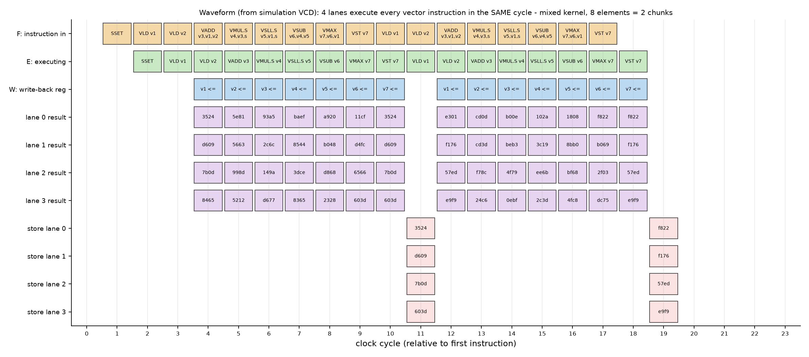

# SIMD Vector Processing Unit (4 lanes) - Verilog RTL, verification, scalar-vs-SIMD study, FPGA results

**Project 11 - SIMD Vector Processing Unit** (MCA mini-project, Intermediate+).
A parameterised SIMD unit in Verilog (default 4 lanes x 16 bit) with a vector register file, parallel lane ALUs,
vector control unit, lane MUXes, result combiner and scalar interface - plus a gate-level **4-lane SIMD chip built in
Sebastian Lague's Digital Logic Sim (DLS)**, a like-for-like scalar baseline, a verification suite, and measured cycle / throughput /
FPGA-resource / Fmax results.

> Team: **[Member 1], [Member 2], [Member 3], [Member 4], [Member 5]**  |  Demo video: **[add link]**  |  Report: [`report/SIMD_VPU_IEEE_Report.docx`](report/SIMD_VPU_IEEE_Report.docx)


## Headline results (all reproducible with `make`)

| Metric | Result |
|---|---|
| Lane operations | 16: ADD SUB AND OR XOR SLL SRL SRA MUL EQ NE LT GT LTU MIN MAX |
| Throughput | 1 vector instruction / cycle, 4 x 16-bit lane results per cycle, no stalls (full bypass) |
| Scalar vs 4-lane SIMD (64 elements, mixed kernel) | **515 vs 131 cycles = 3.93x** speed-up (98 % efficiency) |
| Wall-clock speed-up on iCE40 HX8K | **3.69x** (Fmax 47.4 MHz scalar vs 44.4 MHz 4-lane) |
| Scaling | 2 / 4 / 8 / 16 lanes: 1.99x / 3.93x / 7.69x / 14.71x |
| Area (4 lanes, iCE40) | 4041 LUT4, 883 FF (scalar: 1153 LUT4, 352 FF) |
| Area (4 lanes, Xilinx 7-series estimate) | 1990 LUT, 883 FF, 4 DSP48E1 |
| Fmax (nextpnr, best of 4 seeds) | iCE40 HX8K: 47.4 / 47.0 / 44.4 MHz for 1 / 2 / 4 lanes; UP5K (DSP): 23.0 / 21.6 / 21.6 MHz |
| Verification | 1,048,576-case exhaustive ALU test; ~21k-instruction self-checking random + directed TB on 8 (LANES, W) configs with coverage closure; 192 golden vectors x 2 widths; **mutation score 21/21** |

Full tables: [`results/RESULTS.md`](results/RESULTS.md).  Frequencies are iCE40 (slow fabric) numbers; Xilinx figures are a Yosys estimate - see *Limitations*.


## Repository map

| Path | Content |
|---|---|
| `rtl/` | SIMD RTL: `lane_alu`, `simd_lane`, `vreg_file`, `vec_ctrl`, `result_combiner`, `simd_vpu` (top), `scalar_baseline`, `simd_defs.vh` |
| `tb/` | Testbenches: `tb_lane_alu` (exhaustive), `tb_simd_vpu` (self-checking + coverage), `tb_perf` (scalar vs SIMD), `tb_vectors` (golden vectors) |
| `synth/` | `bench_top.v` - wrapper used for Fmax measurement |
| `scripts/` | Python scripts behind the `make` targets, and the test-vector generator |
| `vectors/` | Golden test vectors and printable DLS cross-check sheets |
| `dls/` | Digital Logic Sim SIMD_4LANE design and screenshots |
| `results/` | Measured results: `RESULTS.md` (tables), CSVs, regression and mutation reports |
| `docs/` | `ARCHITECTURE.md` and figures |
| `report/` | IEEE-format project report |

## Quick start

Requirements: Icarus Verilog (tested with 13), Yosys, nextpnr-ice40, Python 3. On macOS: `brew install icarus-verilog yosys nextpnr-ice40`.

```bash
make test        # regression: ALU exhaustive + system TB (8 configs) + golden-vector replay
make mutation    # 21 injected bugs, all must be caught
make perf        # scalar (1 lane) vs 2/4/8/16 lanes -> results/perf_cycles.csv
make demo        # cycle-by-cycle trace of the 4-lane run
make synth       # FPGA resources and Fmax (~10 min)
```

`LANES` and `W` are parameters of every module, e.g.:
```bash
iverilog -g2012 -I rtl -Ptb_simd_vpu.LANES=8 -Ptb_simd_vpu.W=16 -o build/t.vvp tb/tb_simd_vpu.v rtl/*.v && vvp build/t.vvp
```
(no space after `-P`).

## How the SIMD unit works (short)

* **ISA** - 32-bit instruction: `cls[31:29] op[28:25] vd[24:22] vs1[21:19] vs2[18:16] imm[15:0]`. Classes: VV (`vd = vs1 op vs2`), VS (second operand = broadcast scalar), VLD, VST, VSPLAT, SSET, VEXT, NOP. Compare ops return all-ones/zero per lane (usable as AND masks).
* **Pipeline** - F (decode + hazard check, registered) -> E (register read + bypass, LANES x ALU, combine) -> W (write-back). One instruction per cycle, 2-cycle fill, no stalls.
* **Scalar baseline** - the *same* RTL with `LANES=1` (`scalar_baseline.v`) running the same program; therefore the comparison isolates data-level parallelism.
* **Scalar interface** - external scalar-register write, scalar broadcast operand, and `VEXT` lane extract.
* **Performance counters** - cycles, instructions, lane-ops in hardware (`perf_*` outputs).
Details: [`docs/ARCHITECTURE.md`](docs/ARCHITECTURE.md).



## Digital Logic Sim implementation
The same 4-lane concept was built from gates in Digital Logic Sim - see [`dls/README.md`](dls/README.md).
`vectors/DLS_TEST_SHEET_L4_W8.md` lists golden inputs/outputs; the same vectors are verified against the RTL (`tb/tb_vectors.v`), so RTL == Python model == DLS chip.

## Limitations (honest notes)
* Load/store bandwidth is assumed to scale with lane count (ideal memory); real systems would be bandwidth-limited.
* N = 64 elements, so the 2-cycle pipeline fill is visible (efficiency 98 % at 4 lanes, 92 % at 16).
* Fmax is from iCE40 place-and-route (nextpnr); Xilinx numbers are a Yosys *estimate* (LUT/FF/DSP counts, no timing). 
* The vector register file is flip-flop based (main FF cost); no divide, saturation, widening, or lane masking.
* Pipeline optimisation (decode in F, pre-computed bypass) gave about +5 % Fmax at 4 lanes and no measurable change at 1 lane (`results/fmax_v1_vs_v2.csv`).
