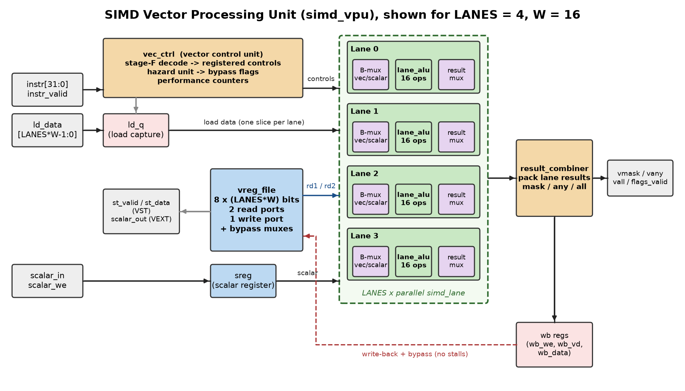
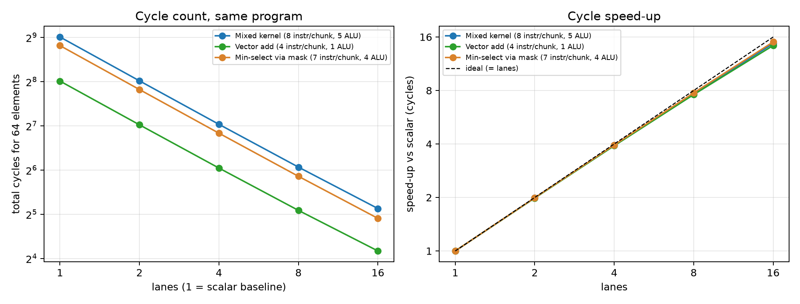

# SIMD Vector Processing Unit - 4 lanes (Digital Logic Sim + Verilog)

**Project 11 - SIMD Vector Processing Unit.** A SIMD unit performs the *same* operation on several data elements at once.
We built a **4-lane x 8-bit SIMD chip from gates in Sebastian Lague's Digital Logic Sim (DLS)**, wrote a **Verilog mirror of every DLS chip**
(verified against the DLS screenshots), generalised the idea into a **parameterised, pipelined Verilog SIMD core**, and compared **scalar vs SIMD** in
cycle count, throughput, FPGA resources and maximum frequency.

> Newton School of Technology, Rishihood University - Team: **Harshit Shakya, Ishan Maheshwari, Shreyansh Agrawal, Tanishk Agrawal, Divyanshu Raj**  |  Demo video: **[Google Drive](https://drive.google.com/drive/folders/1zw468s2CdlDu44fKuawNaervDMlK7zZC?usp=sharing)**  |  Report: [`report/SIMD_VPU_IEEE_Report.docx`](report/SIMD_VPU_IEEE_Report.docx)

## 1. The design we built: `SIMD_4LANE` in Digital Logic Sim + Verilog mirror
`SIMD_4LANE` was built bottom-up from gates in Digital Logic Sim: **VECTOR-REGISTER-FILE (8 x 8-bit) -> 4 x 8-Bit-ALU -> RESULT-REGISTER-FILE (4 x 8-bit)**,
one shared 3-bit opcode (ADD, SUB, AND, OR, XOR, COMPARE) driving four ALUs in parallel (e.g. `[10,20,30,40] - [1,2,3,4] = [9,18,27,36]` in a single step).
All screenshots, the chip-by-chip explanation and the opcode table are in **[`dls/README.md`](dls/README.md)**.


**Verilog mirror ([`dls_rtl/`](dls_rtl/))** - one Verilog module per DLS chip (`full_adder`, `rc_adder8`, `subtractor8`, `alu8`, `register8_en`, `vector_register_file`, `result_register_file`, `simd_4lane`, ...).
`make dls` replays the exact screenshot cases and runs exhaustive, equivalence and streaming tests. Results (`results/DLS_MIRROR_RESULTS.md`):

| DLS-style design | Result |
|---|---|
| Screenshot cases | 6 ALU operations + vector subtract: all match |
| Scalar vs SIMD (64 elements) | **66 cycles (1 lane) vs 18 cycles (4 lanes) = 3.67x**; 2 / 8 / 16 lanes: 1.94x / 6.60x / 11.0x |
| FPGA resources, 4 lanes | **257 LUT4, 96 FF** (iCE40); 134 LUT, 96 FF (Xilinx-7 estimate) |
| Fmax, iCE40 HX8K | ~160 MHz (1 lane) / ~162 MHz (4 lanes) |
| Mutation check | 9 / 9 injected bugs detected |

**Generalised RTL ([`rtl/`](rtl/))** - the same idea extended into a parameterised, pipelined unit (16 operations, any lane count / width, scalar interface, bypassing) used for the wider scaling study below.
The DLS operations are a subset of it: DLS opcodes `000-100` equal RTL ops ADD, SUB, AND, OR, XOR, and COMPARE = RTL `EQ` (`tb_dls_mirror` proves the two ALUs equivalent for all 393,216 input combinations).

## 2. Generalised Verilog RTL - scaling study

A parameterised SIMD unit (default 4 lanes x 16 bit) with a vector register file, parallel lane ALUs, vector control unit with hazard bypass, lane MUXes,
result combiner and scalar interface; the scalar baseline is the same RTL with one lane.



### Headline results of the generalised RTL (all reproducible with `make`)

| Metric | Result |
|---|---|
| Lane operations | 16: ADD SUB AND OR XOR SLL SRL SRA MUL EQ NE LT GT LTU MIN MAX |
| Throughput | 1 vector instruction / cycle, 4 x 16-bit lane results per cycle, no stalls (full bypass) |
| Scalar vs 4-lane SIMD (64 elements, mixed kernel) | **515 vs 131 cycles = 3.93x** speed-up (98 % efficiency) |
| Wall-clock speed-up on iCE40 HX8K | **3.69x** (Fmax 47.4 MHz scalar vs 44.4 MHz 4-lane) |
| Scaling | 2 / 4 / 8 / 16 lanes: 1.99x / 3.93x / 7.69x / 14.71x |
| Area (4 lanes, iCE40) | 4041 LUT4, 883 FF (scalar: 1153 LUT4, 352 FF) |
| Area (4 lanes, Xilinx 7-series estimate) | 1990 LUT, 883 FF, 4 DSP48E1 |
| Fmax (nextpnr, best of 4 seeds) | iCE40 HX8K: 47.4 / 47.0 / 44.4 MHz for 1 / 2 / 4 lanes; UP5K (DSP): 23.0 / 21.6 / 21.6 MHz |
| Verification | 1,048,576-case exhaustive ALU test; ~21k-instruction self-checking random + directed TB on 8 (LANES, W) configs with coverage closure; 192 golden vectors x 2 widths; **mutation score 21/21** |

Full tables: [`results/RESULTS.md`](results/RESULTS.md).  Frequencies are iCE40 (slow fabric) numbers; Xilinx figures are a Yosys estimate - see *Limitations*.



## Repository map

| Path | Content |
|---|---|
| `dls_rtl/` | **Verilog mirror of the Digital Logic Sim chips** (one module per DLS chip) |
| `rtl/` | Generalised SIMD RTL: `lane_alu`, `simd_lane`, `vreg_file`, `vec_ctrl`, `result_combiner`, `simd_vpu` (top), `scalar_baseline`, `simd_defs.vh` |
| `tb/` | Testbenches: `tb_dls_mirror`, `tb_dls_perf` (DLS design); `tb_lane_alu`, `tb_simd_vpu`, `tb_perf`, `tb_vectors` (generalised RTL) |
| `synth/` | `bench_top.v` - wrapper used for Fmax measurement |
| `scripts/` | Python scripts behind the `make` targets, and the test-vector generator |
| `vectors/` | Golden test vectors and printable DLS cross-check sheets |
| `dls/` | **Digital Logic Sim SIMD_4LANE**: screenshots, chip-by-chip explanation, opcode table |
| `results/` | Measured results: `RESULTS.md` (tables), CSVs, regression and mutation reports |
| `docs/` | `ARCHITECTURE.md`, figures |
| `report/` | IEEE-format project report |

## Team and contributions

| Member | Roll no. | Contribution |
|---|---|---|
| Harshit Shakya | 2401010183 | Digital Logic Sim: ALU chips, adder/subtractor, comparator, multiplexers; completed the `SIMD_4LANE` build on the simulator |
| Ishan Maheshwari | 2401010194 | Digital Logic Sim: registers, `VECTOR-REGISTER-FILE`, `RESULT-REGISTER-FILE` |
| Shreyansh Agrawal | 2401010447 | Verilog mirror of the DLS chips and the generalised parameterised RTL |
| Tanishk Agrawal | 2401020071 | Testbenches, functional coverage, mutation testing |
| Divyanshu Raj | 2401010160 | Synthesis and Fmax study, benchmarks, project report |

## Quick start

Requirements: Icarus Verilog (tested with 13), Yosys, nextpnr-ice40, Python 3. On macOS: `brew install icarus-verilog yosys nextpnr-ice40`.

```bash
make dls         # DLS-chip Verilog mirror: screenshot cases, tests, mutation check, 1-vs-4-lane cycles
make test        # full regression: DLS mirror + ALU exhaustive + system TB (8 configs) + golden vectors
make mutation    # 21 injected bugs, all must be caught
make perf        # scalar (1 lane) vs 2/4/8/16 lanes -> results/perf_cycles.csv
make demo        # cycle-by-cycle trace of the 4-lane run
make dls-full    # + FPGA resources and Fmax of the DLS-style design (~5 min)
make synth       # FPGA resources and Fmax of the generalised RTL (~10 min)
```

`LANES` and `W` are parameters of every module, e.g.:
```bash
iverilog -g2012 -I rtl -Ptb_simd_vpu.LANES=8 -Ptb_simd_vpu.W=16 -o build/t.vvp tb/tb_simd_vpu.v rtl/*.v && vvp build/t.vvp
```
(no space after `-P`).

## How the generalised RTL works (short)

* **ISA** - 32-bit instruction: `cls[31:29] op[28:25] vd[24:22] vs1[21:19] vs2[18:16] imm[15:0]`. Classes: VV (`vd = vs1 op vs2`), VS (second operand = broadcast scalar), VLD, VST, VSPLAT, SSET, VEXT, NOP. Compare ops return all-ones/zero per lane (usable as AND masks).
* **Pipeline** - F (decode + hazard check, registered) -> E (register read + bypass, LANES x ALU, combine) -> W (write-back). One instruction per cycle, 2-cycle fill, no stalls.
* **Scalar baseline** - the *same* RTL with `LANES=1` (`scalar_baseline.v`) running the same program; therefore the comparison isolates data-level parallelism.
* **Scalar interface** - external scalar-register write, scalar broadcast operand, and `VEXT` lane extract.
* **Performance counters** - cycles, instructions, lane-ops in hardware (`perf_*` outputs).
Details: [`docs/ARCHITECTURE.md`](docs/ARCHITECTURE.md).


## Limitations (honest notes)
* DLS-style design: one operation per pass (no instruction decode, no result feedback path); opcodes `110` / `111` are reserved and do nothing. The DLS project files are in `dls/project/`.
* Load/store bandwidth is assumed to scale with lane count (ideal memory); real systems would be bandwidth-limited.
* N = 64 elements, so the 2-cycle pipeline fill is visible (efficiency 98 % at 4 lanes, 92 % at 16).
* Fmax is from iCE40 place-and-route (nextpnr); Xilinx numbers are a Yosys *estimate* (LUT/FF/DSP counts, no timing). 
* The vector register file is flip-flop based (main FF cost); no divide, saturation, widening, or lane masking.
* Pipeline optimisation (decode in F, pre-computed bypass) gave about +5 % Fmax at 4 lanes and no measurable change at 1 lane (`results/fmax_v1_vs_v2.csv`).
