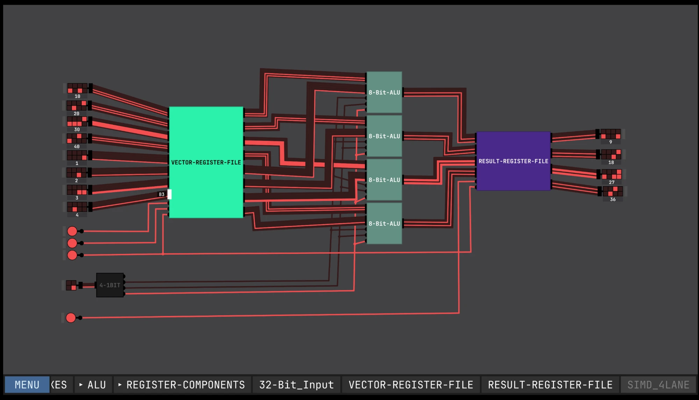
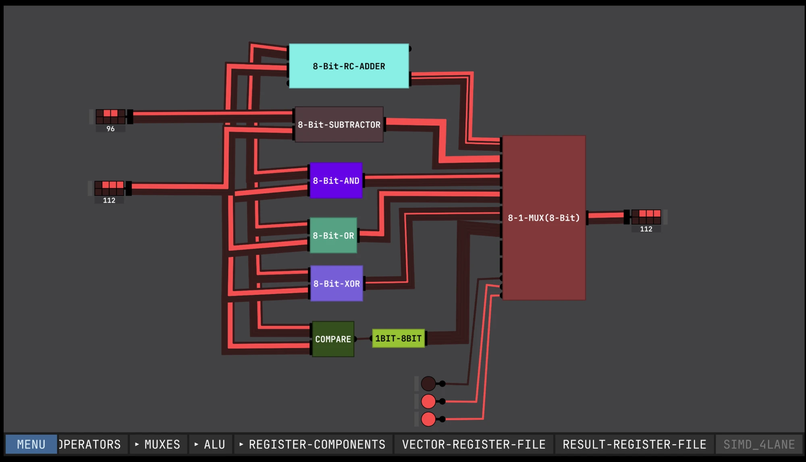
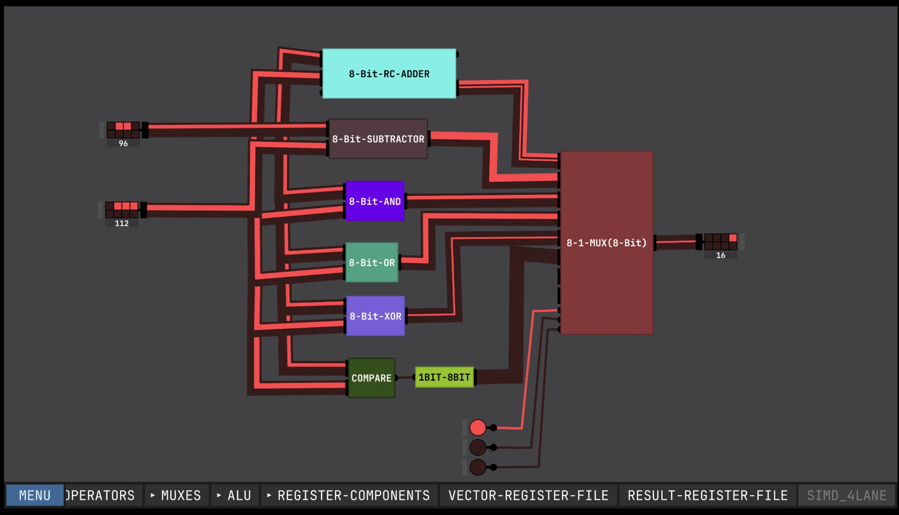
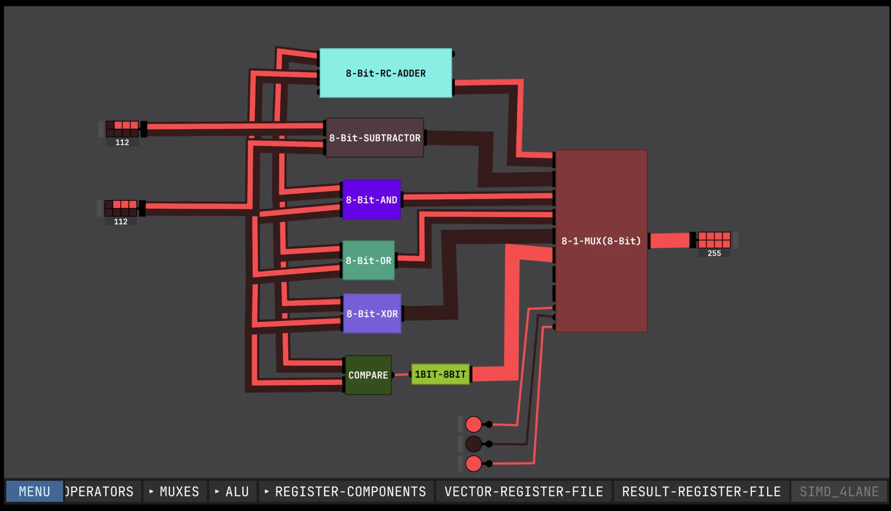
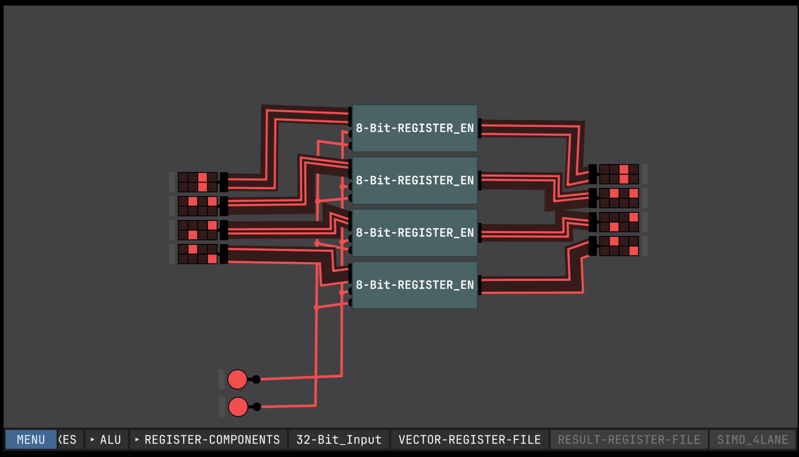
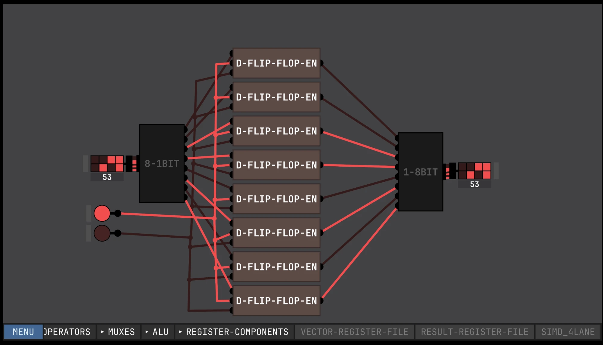

# Digital Logic Sim design - `SIMD_4LANE`

A gate-level **4-lane x 8-bit SIMD unit** (32-bit vectors) built bottom-up in Sebastian Lague's *Digital Logic Sim*.
One instruction (a 3-bit opcode) drives **four identical 8-bit ALUs** that process four byte-lanes of two operand vectors **in parallel**.
Every chip below has a Verilog counterpart in [`../dls_rtl/`](../dls_rtl/) that is verified against the screenshots in this folder.

```
 A[4 x 8 bit] --\                                                   /--> RESULT-REGISTER-FILE --> R[4 x 8 bit]
                 >-- VECTOR-REGISTER-FILE --> 4 x 8-Bit-ALU (parallel) --/
 B[4 x 8 bit] --/        (8 registers)            ^ opcode (3 bits, shared)     (4 registers)
```

## 1. Top level - `SIMD_4LANE`


* **Inputs (left):** operand vector **A** = 10, 20, 30, 40 and operand vector **B** = 1, 2, 3, 4 (eight 8-bit inputs), four single-bit control inputs, and a 4-bit control input that a `4-1BIT` chip splits into single-bit lines for the ALUs.
* **VECTOR-REGISTER-FILE** (green) stores A and B. Its outputs feed the **four `8-Bit-ALU`** chips (lane 0-3) - each lane receives one byte of A and the matching byte of B.
* **RESULT-REGISTER-FILE** (purple) captures the four lane results.
* **Outputs (right):** 9, 18, 27, 36 = A - B lane by lane (opcode SUB). Four subtractions happened in the same step.

## 2. Lane datapath - `8-Bit-ALU` (one lane, six operations)
Five operator chips and a comparator all see the same inputs A and B; the **`8-1-MUX(8-Bit)`** picks one result with the 3-bit opcode (the three select bulbs at the bottom).

| Opcode (S2 S1 S0) | Operation | Chip | Screenshot test (A, B -> result) |
|:--:|---|---|---|
| `000` | ADD | `8-Bit-RC-ADDER` | 64 + 96 = **160** |
| `001` | SUB | `8-Bit-SUBTRACTOR` | 112 - 96 = **16** |
| `010` | AND | `8-Bit-AND` | 96 & 112 = **96** |
| `011` | OR | `8-Bit-OR` | 96 \| 112 = **112** |
| `100` | XOR | `8-Bit-XOR` | 96 ^ 112 = **16** |
| `101` | COMPARE | `COMPARE` -> `1BIT-8BIT` | 112 vs 112 -> **255** (all ones = true) |
| `110`, `111` | not used | mux inputs unconnected | - |

| ADD `000` | SUB `001` | AND `010` |
|---|---|---|
|  |  |  |

| OR `011` | XOR `100` | COMPARE `101` |
|---|---|---|
|  |  |  |

(The opcode values were read directly from the lit/unlit select bulbs in these screenshots, top bulb = most significant bit.)
`COMPARE` produces one bit; `1BIT-8BIT` copies it into all eight bits, so a true comparison reads 255 and can be used as a lane mask.

## 3. Storage
| Chip | Screenshot | What it is |
|---|---|---|
| `VECTOR-REGISTER-FILE` |  | **8** x `8-Bit-REGISTER_EN` = 4 bytes of operand A + 4 bytes of operand B; three control inputs |
| `RESULT-REGISTER-FILE` |  | **4** x `8-Bit-REGISTER_EN` = the four lane results; two control inputs |
| `8-Bit-REGISTER_EN` |  | `8-1BIT` splitter -> **8** x `D-FLIP-FLOP-EN` -> `1-8BIT` merger (value 53 stored in the screenshot) |

## 4. Chip library (bottom-up build)


`FULL_ADDER` -> `8-Bit-RC-ADDER` -> `8-Bit-SUBTRACTOR` (collection `ADDER_SUBTRACTOR`) | `8-Bit-AND/OR/XOR` (`8-Bit-OPERATORS`) | `2-1-MUX`, `2-1-DEMUX`, `8-1-MUX`, `2-1-MUX(8-Bit)`, `8-1-MUX(8-Bit)` (`MUXES`) |
`8-Bit-ALU` | `D-Latch` -> `D-FLIP-FLOP` -> `D-FLIP-FLOP-EN` -> `8-Bit-REGISTER` / `8-Bit-REGISTER_EN` (`REGISTER-COMPONENTS`) | `32-Bit_Input`, `VECTOR-REGISTER-FILE`, `RESULT-REGISTER-FILE`, `SIMD_4LANE`.

## 5. DLS chip -> Verilog module (all in `dls_rtl/`)

| DLS chip | Verilog file / module |
|---|---|
| `FULL_ADDER` | `full_adder.v` / `full_adder` |
| `8-Bit-RC-ADDER` | `rc_adder8.v` / `rc_adder8` (8 x full_adder, ripple carry) |
| `8-Bit-SUBTRACTOR` | `subtractor8.v` / `subtractor8` (a + ~b + 1) |
| `8-Bit-AND / OR / XOR` | `bitwise8.v` / `and8`, `or8`, `xor8` |
| `COMPARE`, `1BIT-8BIT` | `compare8.v` / `compare8`, `bit_to_byte` |
| `8-1-MUX(8-Bit)` | `mux8to1_8bit.v` |
| **`8-Bit-ALU`** | `alu8.v` / `alu8` |
| `D-FLIP-FLOP-EN`, `8-Bit-REGISTER_EN` | `registers.v` / `dff_en`, `register8_en` |
| `VECTOR-REGISTER-FILE`, `RESULT-REGISTER-FILE` | `register_files.v` |
| **`SIMD_4LANE`** | `simd_lanes.v` / `simd_4lane` (`simd_lanes` is the same design with a `LANES` parameter; `LANES = 1` is the scalar baseline) |

## 6. Evidence that the Verilog equals the DLS chip
Run `make dls` (about 30 s). Output (abridged):
```
ALU ADD  opcode=000  A= 64  B= 96  ->  160   (DLS screenshot shows 160)  MATCH      ... SUB, AND, OR, XOR, CMP the same
SIMD_4LANE  SUB  [10,20,30,40] - [1,2,3,4]  ->  [9,18,27,36]   (DLS screenshot shows 9,18,27,36)  MATCH
enable gating: registers hold when disabled, A and B load independently   OK
524,288 exhaustive ALU checks, 393,216 equivalence checks vs rtl/lane_alu.v, 4,000 random full-chip passes   -> DLS MIRROR TESTS PASSED
mutation check: 9 / 9 injected bugs detected          scalar 66 cycles vs 4 lanes 18 cycles (64 elements) = 3.67x
```
Full numbers (cycles, FPGA resources, Fmax): [`../results/DLS_MIRROR_RESULTS.md`](../results/DLS_MIRROR_RESULTS.md).

## 7. Facts the team must confirm (marked as assumptions in the Verilog)
| # | Item | What we assumed | How to confirm |
|---|---|---|---|
| 1 | What `COMPARE` tests | equality (`A == B`) - the screenshot only shows A = B = 112 -> 255 | key A = 96, B = 112 with opcode `101` and read the output (0 = equality; 255 would mean A <= B, A != B ...). Edit the marked line in `dls_rtl/compare8.v` if different |
| 2 | Roles of the control inputs | `VECTOR-REGISTER-FILE`: load A, load B, clock; `RESULT-REGISTER-FILE`: result enable, clock | hover / test each button in DLS and fix the names in this table and in `docs` if they differ |
| 3 | The 4-bit input + `4-1BIT` chip | carries the opcode bits (3 bits used) | tell us what the 4th bit does, if anything |
| 4 | Opcodes `110` / `111` | unconnected -> output 0 | try them in DLS |
| 5 | `dls/project/` | - | copy your DLS project folder here (see below) |

## 8. Add your DLS project files
Copy the DLS project folder (the one that contains `SIMD_4LANE` and its sub-chips) into `dls/project/` and commit it, so evaluators can open the design in Digital Logic Sim.

## 9. Demo procedure for the video (about 75 s)
1. Open `SIMD_4LANE`; set A = 10, 20, 30, 40 and B = 1, 2, 3, 4; opcode `001` (SUB); pulse load, then the result enable -> outputs 9, 18, 27, 36.
2. Change the opcode to ADD (`000`) -> 11, 22, 33, 44; AND/OR/XOR if you like.
3. Open `8-Bit-ALU`: show the 3-bit select and the six results (64+96=160, 112-96=16, 96&112=96, 96|112=112, 96^112=16, 112==112 -> 255).
4. Open `VECTOR-REGISTER-FILE` (8 registers) and `RESULT-REGISTER-FILE` (4 registers), then one `8-Bit-REGISTER_EN` (8 flip-flops).
