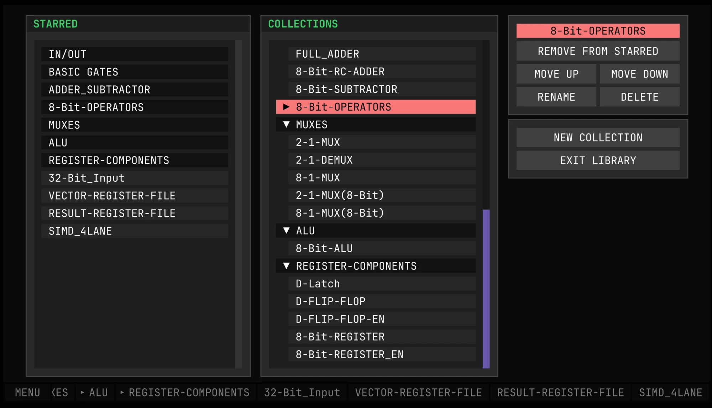

# Digital Logic Sim - SIMD_4LANE

Gate-level **4-lane x 8-bit SIMD chip** (32-bit packed vector) built bottom-up in Sebastian Lague's Digital Logic Sim.
It corresponds to the Verilog configuration `LANES = 4, W = 8`.

## Chip hierarchy (from the DLS library)

| Level | DLS chips |
|---|---|
| Arithmetic | `FULL_ADDER` -> `8-Bit-RC-ADDER` -> `8-Bit-SUBTRACTOR` (collection `ADDER_SUBTRACTOR`) |
| Logic | `8-Bit-OPERATORS` (8-bit-wide logic operations built from `BASIC GATES`) |
| Multiplexing | `2-1-MUX`, `2-1-DEMUX`, `8-1-MUX`, `2-1-MUX(8-Bit)`, `8-1-MUX(8-Bit)` |
| Lane datapath | `8-Bit-ALU` (one lane) |
| Storage | `D-Latch` -> `D-FLIP-FLOP` -> `D-FLIP-FLOP-EN` -> `8-Bit-REGISTER`, `8-Bit-REGISTER_EN` |
| Top level | `32-Bit_Input`, `VECTOR-REGISTER-FILE`, `RESULT-REGISTER-FILE`, `SIMD_4LANE` |

## Mapping to the Verilog design

| DLS chip | Verilog module | Note |
|---|---|---|
| `8-Bit-ALU` (x4 inside `SIMD_4LANE`) | `lane_alu` + `simd_lane` | one lane; the RTL ALU is a superset (16 ops) |
| `8-Bit-RC-ADDER`, `8-Bit-SUBTRACTOR`, `8-Bit-OPERATORS` | arithmetic / logic cases of `lane_alu` | ripple-carry here; synthesis infers carry chains in the RTL |
| `8-1-MUX(8-Bit)` | `case (op)` result select in `lane_alu` | selects the operation result |
| `2-1-MUX(8-Bit)` | operand / source select in `simd_lane` | [confirm: what it selects in your chip] |
| `32-Bit_Input` | `instr_valid`/`ld_data` input bus (4 x 8 = 32 bit) | packed operand vector |
| `VECTOR-REGISTER-FILE` | `vreg_file` | [confirm: number of registers] |
| `RESULT-REGISTER-FILE` | write-back / `wb_data` + `st_data` result path | holds the 4 lane results |
| `D-FLIP-FLOP-EN`, `8-Bit-REGISTER_EN` | registers with write enable in `vreg_file` | |
| `SIMD_4LANE` | `simd_vpu` with `LANES=4, W=8` | top level |

## Facts to fill in (only you know these)

| Item | Value |
|---|---|
| Operations in `8-Bit-ALU` | [list, e.g. ADD, SUB, AND, OR, ...] |
| Opcode encoding (`8-1-MUX` select bits) | [e.g. 3 bits: 000 = ADD ...] |
| Number of vector registers | [n] |
| DLS version | [x.y] |
| Project folder copied into `dls/project/` | [ ] |

## Cross-check procedure (about 15 minutes)
1. Generate a sheet for exactly the operations your ALU has, e.g.
   `python3 scripts/gen_dls_vectors.py --lanes 4 --width 8 --ops ADD,SUB,AND,OR,XOR`
   (writes `vectors/DLS_TEST_SHEET_L4_W8_custom.md`). The full 16-op sheet `vectors/DLS_TEST_SHEET_L4_W8.md` also exists; use only the rows your chip supports.
2. Key operands A and B into the four 8-bit lanes (lane 0 = least-significant byte), select the op, read the 4 result lanes, tick the OK column.
3. Differences are usually conventions (shift amount, signed vs unsigned compare, compare result `1` vs all-ones `FF`) - document them.
4. The same vectors are verified against the Verilog RTL by `make test` (W = 8 and 16), so a match proves RTL = Python model = DLS chip.
